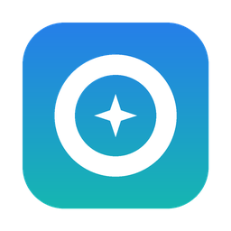

<div align="center">



# Storage Sweep

**The disk cleaner built for developers' Macs.**

Find the gigabytes hiding in `node_modules`, Gradle caches, Xcode simulators, Python environments, AI models and old installers, and clean them up safely in a few clicks.

[](https://github.com/YOUR_USERNAME/StorageSweep/actions/workflows/build.yml)
[](https://github.com/YOUR_USERNAME/StorageSweep/releases/latest)


[](LICENSE)
[](CONTRIBUTING.md)

[Download](#-download) · [Features](#-what-it-finds) · [Safety](#-safe-by-design) · [Build from source](#-build-from-source) · [Contribute](#-contributing)

</div>

---

## 💡 Why Storage Sweep?

"Your disk is almost full" is a rite of passage for developers on a 256 GB MacBook. Generic cleaners go after browser history and system junk, but on a developer's Mac the space usually goes somewhere else:

- **`node_modules` in every project** you ever cloned
- **Gradle, Maven, npm, pip, uv, CocoaPods and Cargo caches** that grow forever
- **Xcode DerivedData, archives and iOS simulators**
- **Android SDKs, emulators and system images**
- **Python virtual environments** from courses and side projects
- **Hugging Face and Ollama models** you downloaded once to try something
- **`.dmg` installers** still sitting in Downloads

Storage Sweep knows where all of these live, tells you how big they are and whether they're safe to remove, and moves what you pick to the Trash. It's native, free, open source, and doesn't need an internet connection.

## ✨ What it finds

| | Section | What it shows |
|---|---|---|
| 💽 | **Overview** | How full your disk is, totals from every scan, and the size of your Trash |
| 🧹 | **Caches & Junk** | App caches, logs, developer caches (Gradle, npm, Maven, pip, uv, Yarn, pnpm, Cargo, Go), Xcode build data, simulators, Android emulators, AI models, iPhone backups |
| 📦 | **Project Dependencies** | `node_modules`, Python `venv` / `.venv`, `.next`, `.dart_tool`, `Pods`, Gradle and Rust build folders across all your projects, with when each project last changed |
| 🐘 | **Large Files** | Everything above 100 MB to 5 GB (you choose), including Photos and iMovie libraries |
| 💿 | **Installers** | `.dmg`, `.pkg`, `.iso`, `.xip` files in Downloads, Desktop and Documents |
| 👯 | **Duplicates** | Identical files compared by SHA-256, with one click to keep the oldest copy |
| 🗂️ | **Applications** | Every app with its size, the size of its leftover data, and when you last opened it |
| 🔭 | **Space Explorer** | Browse any folder sorted by size and drill down to see where the space went |

Every result gets a clear label:

- 🟢 **Safe**: rebuilt or re-downloaded automatically (caches, `node_modules`, build output)
- 🟠 **Review**: could matter to you (large files, apps, duplicates)
- ⚪ **Keep**: part of macOS or protected, so it can't be selected

## 🛡️ Safe by design

Cleaning tools should never be scary. Storage Sweep follows a few hard rules:

- **Nothing is removed without your confirmation**, and the confirmation lists every item.
- **Everything goes to the Trash.** You can put things back until you empty it.
- **Only your home folder and `/Applications` are ever touched.** System folders, your main folders (Desktop, Documents, Library…), Keychains, Preferences and `.ssh` are always protected.
- **Apple's own apps can't be selected.**
- **No network access, no analytics, no accounts.** It only reads file sizes on your Mac.
- **Open source**, so you can read exactly what it does.

## ⬇️ Download

1. Download `StorageSweep.zip` from the [latest release](https://github.com/YOUR_USERNAME/StorageSweep/releases/latest).
2. Unzip it and drag **Storage Sweep** into your Applications folder.
3. Open it. The first time, macOS may say it can't verify the developer. Open **System Settings → Privacy & Security** and click **Open Anyway**.
4. For complete results, allow **Full Disk Access** when the app asks. It walks you through the steps.

**Requirements:** macOS 13 Ventura or later, on Apple silicon or Intel.

## 🛠️ Build from source

You need Xcode 15 or later (or the Xcode command line tools).

```bash
git clone https://github.com/YOUR_USERNAME/StorageSweep.git
cd StorageSweep
./build.sh
open "dist/Storage Sweep.app"
```

`build.sh` builds a universal app (Apple silicon and Intel), signs it ad hoc and creates `dist/StorageSweep.zip`.

Prefer Xcode? **File → Open**, choose the `StorageSweep` folder, select **My Mac** and press **Run**.

## 🗺️ Roadmap

Ideas we'd love help with (see [issues](https://github.com/YOUR_USERNAME/StorageSweep/issues)):

- [ ] Docker images, volumes and build cache
- [ ] Homebrew old versions (`brew cleanup` preview)
- [ ] JetBrains IDE caches for old versions
- [ ] Treemap ("sunburst") view in Space Explorer
- [ ] "Last opened" filter for project folders (for example, untouched for 6 months)
- [ ] Menu bar widget showing free space
- [ ] Scheduled scans with a notification when the disk gets full
- [ ] Localization

## 🤝 Contributing

Contributions of every size are welcome: new cache locations, bug fixes, UI polish, docs or translations. Adding a new cleanup location is often a **one-line change**, which makes it a great first contribution.

Read the [contributing guide](CONTRIBUTING.md) to get started, and look for issues labelled [`good first issue`](https://github.com/YOUR_USERNAME/StorageSweep/labels/good%20first%20issue).

Please follow our [Code of Conduct](CODE_OF_CONDUCT.md). To report a security problem privately, see [SECURITY.md](SECURITY.md).

## 📁 Project structure

```
StorageSweep/
├── Package.swift                Swift package (SwiftUI, macOS 13+)
├── build.sh                     Builds, signs and zips the .app
├── Resources/                   Info.plist and app icon
└── Sources/StorageSweep/
    ├── StorageSweepApp.swift    App entry point and menus
    ├── AppState.swift           Scans, selection and Trash handling
    ├── DiskScanner.swift        All scanning logic and known cache locations
    ├── Safety.swift             Protected paths and permissions
    ├── Models.swift             Data types
    ├── Components.swift         Shared UI pieces
    └── Screens.swift            One screen per section
```

## ❓ FAQ

**Is it safe to delete caches?**
Items marked **Safe** are rebuilt or re-downloaded when needed. The cost is a slower first build or a re-download, not lost work.

**Why does it need Full Disk Access?**
macOS hides some folders (Trash, Mail, some app data) from apps by default. Without access the app still works, but totals come out lower than what's really there.

**Why isn't it on the Mac App Store?**
App Store apps are sandboxed and can't see your whole disk, which a storage cleaner needs to do.

**Does it send any data anywhere?**
No. There's no networking code in the app.

## 📄 License

[MIT](LICENSE) © 2026 Thinula Harischandra and contributors.

<div align="center">

If Storage Sweep freed up space for you, consider giving it a ⭐. It helps other developers find it.

</div>
